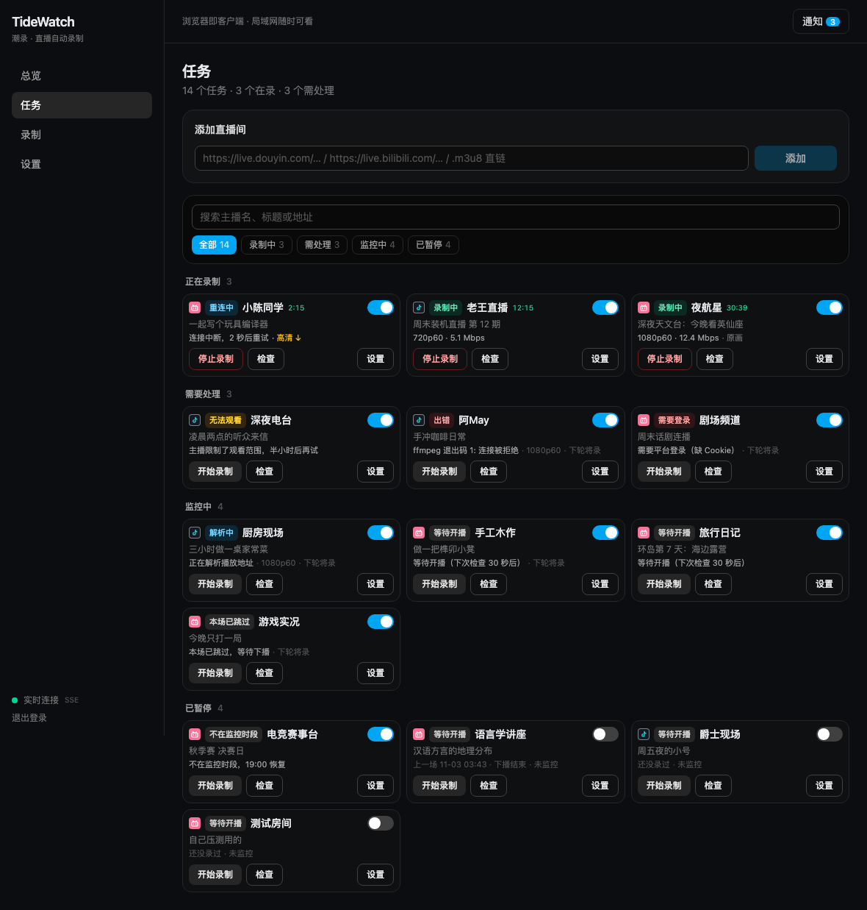
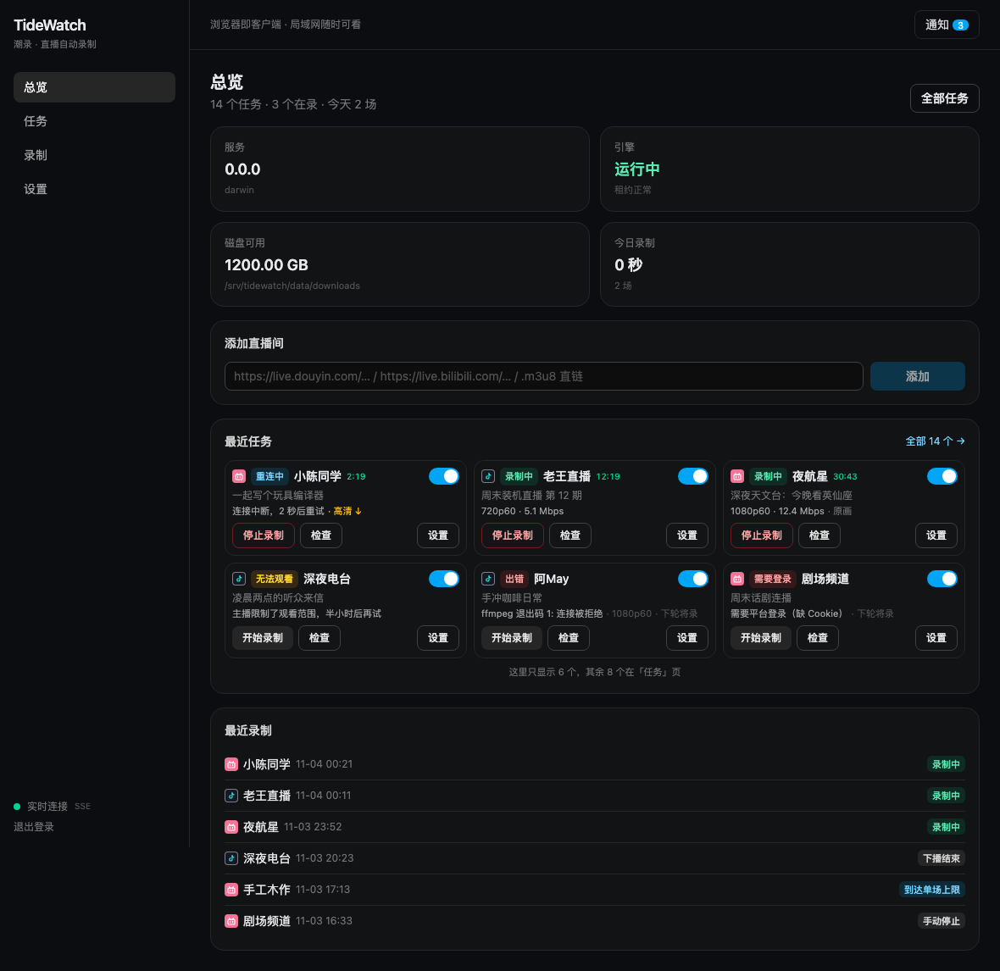

<div align="center">

# TideWatch · 潮录

**给直播间装一台自动录像机 —— 贴一个地址，开播自动录，下播自动出 MP4。**

自托管的直播录制服务：一个常驻进程 + 一个网页界面，手机连同一局域网也能看。
支持抖音、B 站，以及任意 `.m3u8` / `.flv` 直链。

<sub>`v0.0.0` 早期版本 · macOS / Linux · 单进程 · 无需外部数据库 · 不需要桌面客户端</sub>

</div>

---

## 为什么会有这个东西

想存下一场直播，通常只有两个选择：熬到开播手动点录制，或者事后找别人传的切片——前者靠运气，后者靠缘分。

TideWatch 把这件事变成一次配置：**加一个直播间地址，然后忘掉它**。

- 开播了？它已经在录了。下播了？MP4 已经在硬盘上。
- 凌晨三点断流、路由器重启、进程被你顺手 `kill -9`——它会自己接上、自己收尾，不丢已经录好的部分。
- 十几个直播间同时盯着？任务页是卡片墙，一行三列，谁在录、谁要处理、谁只是待命，一眼扫完。

它跑在你自己机器上（NAS、小主机、旧笔记本都行），产物就在你的磁盘里，不经过任何第三方服务。

## 看一眼



> 任务页：**正在录制 / 需要处理 / 监控中 / 已暂停** 四组自动归类，搜索条滚动时钉在顶部。



> 总览页：磁盘余量、今日录制时长、最近任务与最近录制，一屏看完当前状态。

## 能做什么

**录制**

| 能力 | 说明 |
|---|---|
| 自动跟播 | 按间隔轮询直播间状态（默认 30 秒），开播即录、下播即收尾。每个任务一条独立轮询线，互不干扰 |
| 监控时段 | 每个任务可以只看一个时间窗（如 `19:00 → 02:00`，支持跨午夜、最多 3 段）。窗外**一次请求都不发**，到点自动恢复 —— 24 小时 2880 次轮询是平台风控的敞口，也是白问 |
| 会看时段问 | 窗口内也不是死板 30 秒：按这个主播历史上几点开播分冷热（热 30s / 温 60s / 冷 180s），久未开播再翻倍、封顶 10 分钟；解析连续失败走指数退避 |
| 手动接管 | 随时「开始录制 / 停止录制」「立即检查」「本场跳过」，都不影响监控本身。手动操作会无视时段立刻生效 |
| 断流自愈 | 流地址过期或网络抖动时自动重取，缺口记进事件表并在会话时间轴上标出来 |
| 画质可见 | 卡片上直接标出**实际拿到的档位**（`原画` / `高清 ↓`）。平台静默降级（请求原画只给高清且不报错）会被标黄并发一条通知，不用事后猜"为什么录得这么糊" |
| 崩溃可恢复 | 录制用分段 TS 落盘，manifest 是事实源；进程被强杀后下次启动自动恢复、重扫、合并 |
| 硬上限 | 单场时长 / 体积到顶按 `capped` 结束，并自动承接下一场（默认 6 小时、20 GiB） |
| 磁盘保护 | 可用空间低于阈值时拒绝开新的一场，而不是把盘写满 |

**产物**

- 一场一个 MP4（默认 `faststart`，边下边播）；也可以选「每段独立 MP4」或「只留 TS 自己处理」。
- **被切成几场的直播可以拼回来**：录制页勾选几场，一键按时间顺序合成一个视频。流参数中途变了的按组分开输出，两场之间没录到的空档会在合并页标出来 —— 不假装连续。
- 目录按 `主播/日期-时间` 组织，`session.manifest.json` 记录这一场的全部分段与缺口。
- 中间文件可选自动清理，源分段默认保留，方便你事后挑选。

**盯着它**

- 通知渠道：ntfy、Bark、Telegram、SMTP 邮件、Web Push。服务端账本 + 10 分钟去重，不会半夜刷你 200 条。
- 页面顶栏有未读角标，点开就是事件清单；多端同步已读。
- 会话详情里有时间轴（分段、缺口、崩溃抢救标记）、事件流水、审计日志。
- **事件表不会无限长**：状态心跳去重（投影没变不记）、错误流限流；过程事件 7 天、结果事件 90 天，过期**先归档成 gzip NDJSON 再删**（归档失败就不删）。设置页能看到条数与库大小，也能手动归档。
- 出问题一键导出诊断包（脱敏后的配置 + 日志 + 数据库快照），排查不用靠猜。

**用起来**

- 浏览器就是客户端，手机端是底部 Tab 布局，横竖屏都不出横向滚动条。
- 实时更新走 SSE（`/api/events/stream`），服务端或反代不支持时自动回退 WebSocket，侧栏会显示当前用的哪一条。

## 快速开始

### 1) 环境依赖

| 依赖 | 要求 | 说明 |
|---|---|---|
| **Node.js** | **≥ 24**（推荐 26.x） | 用了内置 `node:sqlite`，低版本直接起不来 |
| **pnpm** | 12.x | `packageManager` 已锁定 |
| **Python** | **≥ 3.10**（3.12 / 3.13 最佳） | **仅抓抖音 / B 站时需要**；`.m3u8` 直链不依赖它 |
| ffmpeg / ffprobe | 不用手动装 | 由 `pnpm fetch:ffmpeg` 下到 `vendor/`，程序自己解析 |
| 磁盘 | 按录制量留余量 | 720p60 约 **0.3–0.6 GB/小时** |

**Python 这一项最容易踩坑，值得单独说三句：**

1. **macOS 自带的 `/usr/bin/python3` 是 3.9，不够用。** 插件依赖的抓流库用了 3.10 才有的语法，在 3.9 下导入即崩，界面上表现为任务报错 **「插件未响应就退出」** ——看起来像插件坏了，其实是解释器太旧。先自查：

   ```bash
   python3 -V        # 需要 3.10 及以上
   ```

2. **装一个独立解释器，别依赖系统自带的。** 没有 Homebrew 的话直接装 python.org 官方包（3.12 / 3.13），装完是 `/usr/local/bin/python3.12`；也可以用 pyenv、uv 或已有虚拟环境。程序会按 `TIDEWATCH_PYTHON` → `vendor/python/bin/python3` → PATH 上的 `python3` 顺序找解释器，想指定就：

   ```bash
   TIDEWATCH_PYTHON=/usr/local/bin/python3.12 node packages/server/dist/cli.js serve
   ```

3. **插件依赖不在仓库里**（`site-packages/` 有 21 MB，被 `.gitignore` 排除），clone 下来要自己装一次：

   ```bash
   /usr/local/bin/python3.12 -m pip install \
     -r plugins/streamget-plugin/requirements.lock \
     --target plugins/streamget-plugin/site-packages
   ```

   版本全部钉死在 `requirements.lock` 里，重建不会漂移。装好启动后，「设置 → 插件」应能看到 `streamget v0.2.0 协议 2 douyin bilibili`。

> 详细步骤、二进制三级解析、常见报错对照见 **[使用手册 §2 安装与准备](docs/user-guide.md#2-安装与准备)**。

### 2) 安装与构建

```bash
git clone <repo> && cd TideCapSev
pnpm install
pnpm -r build                     # 7 个 workspace 包（含 UI 静态产物）
pnpm fetch:ffmpeg                 # 下载 ffmpeg + ffprobe，已有则跳过
```

### 3) 启动并登录

```bash
node packages/server/dist/cli.js serve
```

启动横幅会给全你需要的三样东西：

```
  TideWatch daemon 已启动  (pid 56314)
  数据根     /Users/you/TideCapSev/data
  本机访问   http://127.0.0.1:8686
  局域网访问 http://10.0.0.20:8686
  访问 token a1b2c3d4…
```

浏览器打开 <http://127.0.0.1:8686>，粘贴 token 登录即可。token 是首次启动自动生成、固定不变的，随时可以 `node packages/server/dist/cli.js token` 再取。

> 登录有效期 7 天且自动续期；daemon 重启后各端要重新粘一次 token（token 本身不变）。

### 4) 加第一个直播间

在「总览」或「任务」页的输入框里贴地址，点「添加」：

```
https://live.bilibili.com/123456
https://live.douyin.com/123456789
https://example.com/stream.m3u8
```

添加后它会立刻检查一次；在播就开录，不在播就进「等待开播」——之后你不用再管。

## 使用说明

完整手册：**[docs/user-guide.md](docs/user-guide.md)**（18 章，从装到排错）

| 想了解 | 去哪看 |
|---|---|
| 安装、环境依赖、二进制与插件 | [§2 安装与准备](docs/user-guide.md#2-安装与准备) |
| 启动参数、拿 token、换 token | [§3 启动与登录](docs/user-guide.md#3-启动与登录) |
| 四个页面各是什么、手机上怎么用 | [§4 界面导览](docs/user-guide.md#4-界面导览) |
| 添加任务、三个开关怎么组合 | [§5 任务：添加与管理](docs/user-guide.md#5-任务添加与管理) |
| 一场录制从开始到结束发生了什么 | [§6 录制过程](docs/user-guide.md#6-录制过程中到底发生了什么) |
| 产物目录、后处理策略、faststart | [§7 产物与后处理](docs/user-guide.md#7-产物与后处理) |
| 设置项逐条解释 | [§8 设置项全表](docs/user-guide.md#8-设置项全表) |
| 通知渠道怎么配 | [§9 通知](docs/user-guide.md#9-通知) |
| 要原画 / 高清就得给 Cookie | [§10 Cookie 与平台登录态](docs/user-guide.md#10-cookie-与平台登录态) |
| 写自己的平台插件 | [§11 插件](docs/user-guide.md#11-插件) |
| 命令行与 HTTP 接口 | [§12 CLI 参考](docs/user-guide.md#12-cli-参考) · [§13 HTTP API](docs/user-guide.md#13-http-api-参考) |
| 备份、迁移、安全暴露面 | [§14 数据备份](docs/user-guide.md#14-数据备份与迁移) · [§15 安全](docs/user-guide.md#15-安全与暴露面) |
| 出问题了 / 常见疑问 | [§16 故障排查](docs/user-guide.md#16-故障排查) · [§17 FAQ](docs/user-guide.md#17-faq) |

## 常用命令

| 命令 | 作用 |
|---|---|
| `node packages/server/dist/cli.js serve` | 启动（唯一常驻形态）；`-p` 端口、`-H` 监听地址、`-d` 数据根 |
| `… cli.js stop` | 优雅停止：等录制收尾 → 超时硬杀 → 下次启动恢复扫描 |
| `… cli.js status` | daemon 健康状态（JSON） |
| `… cli.js token` | 打印访问 token |
| `… cli.js add <url>` | 命令行加任务，`--no-monitor` 只加不监控 |
| `… cli.js record <taskId> [--stop]` | 手动录 / 停这一场 |
| `… cli.js diagnose` | 导出诊断包到 `<data>/exports/` |
| `… cli.js service install\|uninstall\|status` | 开机自启（launchd / systemd --user / 计划任务） |

## 配置

优先级：**环境变量 > 设置页（存 sqlite）> 内置默认**。

| 变量 | 作用 |
|---|---|
| `TIDEWATCH_DATA_ROOT` | 数据根（默认仓库根的 `data/`） |
| `TIDEWATCH_FFMPEG` / `TIDEWATCH_FFPROBE` | 指定二进制绝对路径，优先级最高 |
| `TIDEWATCH_PYTHON` | 插件用的 Python 解释器（**建议显式指定 ≥3.10 的路径**） |
| `TIDEWATCH_SECURE_COOKIE=1` | HTTPS 反代下给会话 cookie 加 `Secure` |

设置页里可调：轮询间隔（5–3600s，默认 30）、分段时长（30–43200s，默认 1800）、默认后处理、
faststart 阈值、中间文件清理、通知渠道、录制目录。轮询间隔与录制目录**重启生效**，其余立即生效。

## 部署

```bash
# 服务化（当前用户，无需 root），日志在 <data>/logs/
node packages/server/dist/cli.js service install

# 只想本机用，或前面挂反代 / 隧道
node packages/server/dist/cli.js serve -H 127.0.0.1
```

**安全底线**：能访问这个端口的人就能删你的录制，token 是唯一门槛。不要把 8686 直接暴露到公网；
走 HTTPS 反代时加 `TIDEWATCH_SECURE_COOKIE=1`，并给 SSE 端点关掉缓冲（否则实时通道会静默失效，
手册 [§15](docs/user-guide.md#15-安全与暴露面) 有 nginx / Caddy 的写法）。登录接口默认限速 5 次/分钟。

## 技术架构

```
packages/ui        React 19 + Vite 8 + Tailwind 4，构建产物由 server 静态分发
      │  REST + SSE（主）/ WebSocket（回退）
packages/server    Fastify 5：鉴权、任务/会话/设置/通知/插件/诊断路由，SPA 分发
      │
packages/core      引擎：轮询、录制、分段、重连、恢复、合并（纯函数 + Runner，无 IO）
      │
packages/store     node:sqlite（WAL）迁移与查询
packages/protocol  插件清单、启动计划、stdio JSON 协议（协议 2）
packages/host-adapter  平台差异（路径、进程、钥匙串、租约、服务注册）
packages/notify    通知渠道扇出
plugins/streamget-plugin  Python 插件：抖音 / B 站抓流
```

引擎层不认识任何操作系统细节，所有 IO 都从 `HostAdapter` 或注入端口进来——这是它能被单测覆盖的原因。
开发：`pnpm dev`（服务端 tsx watch）+ `pnpm dev:ui`（Vite，`/api` 反代到 8686），门禁 `pnpm test` / `lint` / `typecheck`。

## 边界：它故意不做的事

- **不是下载器**：不做批量扒视频、不做转码流水线，只落 TS 与合并后的 MP4。
- **不碰 DRM**、不破解付费内容；需要登录态的平台请自备 Cookie。
- **没有桌面壳**，所以没有系统级通知——通知必须走服务端渠道（ntfy / Bark / Telegram / 邮件 / Web Push）。
- **不做云**：没有账号体系、没有同步、没有中转，数据只在你自己的机器上。

## 已知限制

- 画质只走匿名档位：B 站匿名最高 720p60（`qn=250` 超清），原画需要登录 Cookie；`quality_options` 目前只报一个可选值。
- 删除任务会级联删掉它的会话索引（**磁盘视频不删**）；要留历史就只关监控、别删任务。
- daemon 重启后登录会话清空，各端需重新粘一次 token。
- 通知渠道失败只写审计日志，不自动重试。
- Docker / brew formula / 反代模板尚未提供，服务化目前走 `service install`。

## 更多文档

| 文档 | 内容 |
|---|---|
| [docs/user-guide.md](docs/user-guide.md) | 使用手册（面向使用者，18 章） |
| [docs/00-m0-skeleton-and-host-adapter.md](docs/00-m0-skeleton-and-host-adapter.md) | 骨架与平台适配设计 |
| [docs/01-ui-redesign.md](docs/01-ui-redesign.md) | UI 信息架构与页面设计 |
| [docs/02-daemon-stack.md](docs/02-daemon-stack.md) | 守护进程技术栈、SSE 选型与运行时约束 |
| [docs/test-matrix.md](docs/test-matrix.md) · [docs/manual-test.md](docs/manual-test.md) | 测试矩阵与真机验收手册 |

## 许可证

暂未指定（当前为私有项目）。
